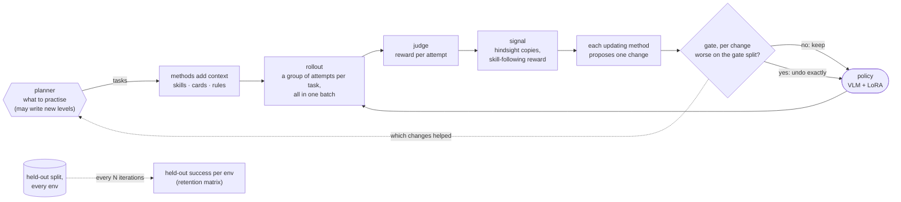

# picoRSI

A small, readable stack for **multimodal self-evolving agents**, in plain PyTorch.

A VLM agent acts in verifiable environments (FrozenLake, Sokoban, Craftax, VQA). Every iteration it
picks what to practise, tries it a few times, and turns what happened (successes *and* failures) into
changes to itself: its LoRA weights, a library of skills, rules and lessons. A gate keeps each change only
if it does not make the agent worse on tasks the loop never trains on. GRPO, PPO, LoRA, ViSkill cards,
hindsight relabelling, ExpeL, Reflexion, TSCL, ACCEL, Voyager, Exp3 and the gate are each written from
scratch, one file per method, named after the method; `transformers` only loads weights and runs the forward pass.

In the spirit of [nanoVLM](https://github.com/huggingface/nanoVLM) and
[picoVLM](https://github.com/patrickamadeus/picovlm): one folder per part, one file per variant,
no framework owning the control flow.

## How one iteration works



| Term | What it is | Where |
|---|---|---|
| **task** | one level or question with a checkable goal; its seed fixes its split | `envs/` |
| **method** | one way the agent changes itself; hooks `context`, `signal`, `propose` / `commit` / `revert` / `persisted`, `observe` | `rsi/base.py` |
| **planner** | picks the tasks (`tasks`) and which methods update (`updates`) | `rsi/base.py` |
| **judge** (verifier) | scores **one attempt** | `rsi/judges.py` |
| **gate** | scores **one change**: gate split before vs after, with the same sampling noise both times; keeps the change only if nothing got worse | `rsi/gate.py` |

## Where this sits among self-evolving agents

In the terms of the survey of self-evolving agents ([Gao et al., 2025](https://arxiv.org/abs/2507.21046)):

| | picoRSI |
|---|---|
| **what** evolves | the model (LoRA: GRPO, PPO, ReST) and its context (skills, visual cards, rules, reflections) |
| **when** | between episodes (inter-test-time); every change is gated |
| **how** | reward-based (GRPO, PPO, the skill-following reward), imitation of its own successes (ReST, skills, hindsight), and learning from its own failures (hindsight, ExpeL, Reflexion) |
| **self-initiated** | the planner chooses what to practise (TSCL; Voyager, where the policy itself picks), writes new levels (ACCEL), and chooses how to learn (Exp3 over the update methods) |
| **evaluated as** | held-out success per env, a retention matrix across lifelong stages (`env: frozenlake>sokoban>craftax`), MMStar for forgetting, everything against cost |

## Methods and planners

Every file below is one method, named after its paper. Any combination is one line of YAML
(`methods: [hindsight, viskill, grpo]`), and each updating method is gated on its own.

| `methods:` | file | changes | learns from |
|---|---|---|---|
| `grpo` | `rsi/grpo.py`: GRPO ([Shao et al., 2024](https://arxiv.org/abs/2402.03300)) | LoRA weights | groups with mixed outcomes |
| `ppo` | `rsi/ppo.py`: PPO with a value head ([Schulman et al., 2017](https://arxiv.org/abs/1707.06347)) | LoRA weights + head | every attempt |
| `rest` | `rsi/rest.py`: ReST / STaR self-training ([Gulcehre et al., 2023](https://arxiv.org/abs/2308.08998)) | LoRA weights | its own successes, hindsight copies included |
| `memory` | `rsi/memory.py`: a skill library, formats `action` · `text` · `text+action` | skills | its own successes |
| `viskill` | `rsi/viskill.py`: ViSkill ([Li et al., 2026](https://arxiv.org/abs/2610.12403)) | visual skill cards | successes; failures earn a skill-following reward |
| `hindsight` | `rsi/hindsight.py`: HER ([Andrychowicz et al., 2017](https://arxiv.org/abs/1707.01495)) | nothing (a signal) | failures, relabelled to the goal they did reach |
| `expel` | `rsi/expel.py`: ExpeL ([Zhao et al., 2024](https://arxiv.org/abs/2308.10144)) | rules | success-vs-failure pairs |
| `reflexion` | `rsi/reflexion.py`: Reflexion ([Shinn et al., 2023](https://arxiv.org/abs/2303.11366)) | lessons | failures |

| `planner:` / `update_planner:` | file | decides |
|---|---|---|
| `uniform`, `frontier` | `rsi/curriculum.py` | baselines: uniform; tasks near 50% success |
| `tscl` | `rsi/tscl.py`: Teacher-Student Curriculum Learning ([Matiisen et al., 2017](https://arxiv.org/abs/1707.00183)) | the level whose success is changing fastest |
| `accel` | `rsi/accel.py`: ACCEL ([Parker-Holder et al., 2022](https://arxiv.org/abs/2203.01302)) | replays uncertain levels and *edits them into new ones* |
| `voyager` | `rsi/voyager.py`: Voyager's curriculum ([Wang et al., 2023](https://arxiv.org/abs/2305.16291)) | the policy itself picks, from its own record and from new levels |
| `update_planner: exp3` | `rsi/exp3.py`: Exp3 ([Auer et al., 2002](https://doi.org/10.1137/S0097539701398375)) | which method updates, learned from gate results |

## Environments

| `env:` | file | task | solver | descriptor | relabel | edit |
|---|---|---|:-:|:-:|:-:|:-:|
| `static` | `envs/static.py` | count squares; gather in order (CPU, CI) | | | | |
| `cauldron` | `envs/cauldron.py` | checkable turns of The Cauldron (real VQA) | | | | |
| `frozenlake` | `envs/frozenlake.py` | reach the goal, avoid holes (ViSkill's setting) | BFS | ✓ | ✓ | ✓ |
| `sokoban` | `envs/sokoban.py` | push the box onto the target (ViSkill's setting) | BFS | ✓ | ✓ | ✓ |
| `craftax` | `envs/craftax.py` | unlock an early Craftax-Classic achievement | | ✓ | ✓ | ✓ |

`env: frozenlake>sokoban>craftax` runs the stages in order with one agent and evaluates every stage at
every eval point.

## Extending: copy a template

- **New environment:** copy `envs/template.py` to `envs/<name>.py`. Every method raises
  `NotImplementedError` and says what it must do; the optional hooks (`solve`, `descriptor`, `relabel`,
  `edit`) say which methods they unlock. Then add one branch to `envs/__init__.py`.
- **New method or planner:** copy `rsi/template.py` to `rsi/<method name>.py`, keep the hooks you need,
  and add one branch to `rsi/__init__.py`.

`tests/test_template.py` checks the contract the templates describe, on every real env and method.

## Layout

```
picoRSI.ipynb   the plain loop in one standalone notebook (~150 lines) — start here
train.py        the loop, top to bottom
evaluate.py     held-out success, baselines (--model random), standard benchmarks via lmms-eval
configs/        config.py (every knob) + yaml/ (one file per experiment)
models/         vlm.py (any HF VLM: act_batch / logprobs / embed), lora.py, baselines.py
envs/           base.py (the contract), template.py, static, cauldron, frozenlake, sokoban, craftax
rsi/            base.py (Method, Planner), template.py, one file per method or planner, judges.py, gate.py
utils/          rollout.py (lockstep batched episodes), prompt.py + scaffolds, log.py, plot.py, lmms.py
```

## Quick start

```bash
git clone https://github.com/patrickamadeus/picoRSI.git && cd picoRSI
uv venv --python 3.12 && source .venv/bin/activate
uv pip install -e ".[dev]"

pytest -q                               # CPU, ~1.5 min
python train.py --config tiny           # close a loop on CPU with a tiny random model (~1 min)
```

## Train

```bash
python train.py --config frozenlake                                  # GRPO, Qwen2.5-VL-3B, one GPU
python train.py --config frozenlake --methods viskill,grpo           # ViSkill: cards + reward + GRPO
python train.py --config sokoban --methods hindsight,viskill,expel,reflexion,grpo --planner accel --update_planner exp3
python train.py --config frozenlake --env "frozenlake>sokoban>craftax" --methods viskill,grpo   # lifelong
python train.py --config count_grpo                                  # the original SmolVLM-256M counting run
```

Configs: `tiny` (CPU smoke), `frozenlake`, `sokoban`, `craftax`, `count_grpo`, `count_memory`, `cauldron_grpo`.
Any field can be overridden on the command line.

## Evaluate

```bash
python evaluate.py --config sokoban --model random                        # the chance baseline
python evaluate.py --config sokoban --model Qwen/Qwen2.5-VL-3B-Instruct   # zero-shot
python evaluate.py --run runs/sokoban_grpo                                 # a trained run (LoRA + memory)
python evaluate.py --run runs/sokoban_grpo --benchmarks mmstar             # forgetting, through lmms-eval
```

RESULTS_PLACEHOLDER

## What makes a result here trustworthy

- **Three splits by seed hash**: train 70%, gate 10%, held-out 20%. Planners only ever emit train seeds,
  including the levels ACCEL and Voyager write (enforced in `rsi/base.py`); held-out is frozen per seed.
- **The gate** keeps a change only if it is on disk, changed something, didn't lower gate-split success,
  came from a signal available at deployment, and didn't raise the parse-failure rate. Before and after
  are sampled with the same random draws, so the comparison sees the change rather than sampling noise.
- **Chance and zero-shot baselines** on the same held-out tasks (`--model random`).
- **Matched cost**: every rollout counts, including gate and eval ones. Plot against cost, not iterations.

## Contributing

No `trl`, `peft`, `accelerate` or RL libraries in the loop. A new env, method or planner is one file
(copy a template) plus one line in `envs/__init__.py` or `rsi/__init__.py`, with tests.

## Citation

```bibtex
@misc{irawan2026picorsi,
  author       = {Patrick Amadeus Irawan},
  title        = {picoRSI: a small, readable stack for multimodal self-evolving agents},
  year         = {2026},
  howpublished = {\url{https://github.com/patrickamadeus/picoRSI}}
}
```

## License

Apache-2.0. See [`LICENSE`](LICENSE).
