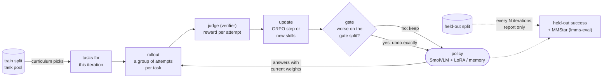
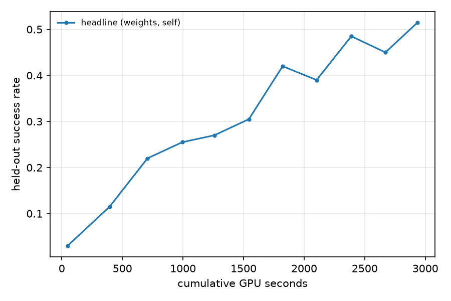

# picoRSI

A small, readable stack for **multimodal self-improvement loops**, in plain PyTorch.

A small VLM acts in a verifiable environment, a judge scores what it did, an update rule turns that
into a durable change, and a gate keeps the change only if it helps on tasks the loop never trains
on. GRPO, LoRA, the curriculum, the skill memory and the gate are written from scratch so you can
read them; `transformers` only loads weights and runs the forward pass.

In the spirit of [nanoVLM](https://github.com/huggingface/nanoVLM) and
[picoVLM](https://github.com/patrickamadeus/picovlm): one folder per part, one file per variant,
no framework owning the control flow.

## How one iteration works



| Term | What it is | Where |
|---|---|---|
| **task** | one image + goal with a checkable answer; its seed fixes its split | `envs/` |
| **scaffold** | the prompt template the policy sees (`{system}`, `{actions}`, `{memory}`, `{task}`) | `utils/scaffold.txt` |
| **rollout** | one episode: the policy answers, the env steps, until done | `utils/rollout.py` |
| **judge** (verifier) | scores **one attempt**: exact match from the env, or a separate VLM | `rsi/judges.py` |
| **update** | turns scored attempts into **one change**: a GRPO step on LoRA, or new skills in memory | `rsi/grpo.py`, `rsi/memory.py` |
| **gate** | scores **the change**: re-runs the gate split before vs after, keeps it only if nothing got worse | `rsi/gate.py` |
| **curriculum** | picks which train tasks to practise next | `rsi/curriculum.py` |

The judge is to the gate what a unit test is to a merge check: the gate uses the judge, but it
decides about the model, not about an answer. The loop is on-policy — every training example is the
current model's own attempt — but it does not yet plan: it never writes tasks or chooses how to update.

## Layout

```
picoRSI.ipynb   the whole loop in one standalone notebook (~150 lines) — start here
train.py        the loop, top to bottom, with every part plugged in
evaluate.py     held-out success on our tasks + standard benchmarks via lmms-eval
generate.py     watch the policy act on one task, step by step
configs/        config.py (every knob) + yaml/ (one file per experiment) + openvlharness/ (agent configs)
models/         smolvlm.py (the policy: act / logprobs / embed), lora.py (from scratch)
envs/           static.py (numpy count & gather tasks, CPU), cauldron.py (real VQA), craftax.py (open-world)
rsi/            grpo.py, memory.py (what changes), curriculum.py (what to practice),
                judges.py (how it's scored), gate.py (what is kept)
utils/          rollout.py (one episode), prompt.py + scaffold.txt (the prompt), log.py, plot.py, lmms.py,
                openvlharness.py (rollouts through OpenVLHarness instead)
```

`envs/__init__.py` and `rsi/__init__.py` map a config name to a file, so every choice is one line of YAML:

| Knob | Values |
|---|---|
| `env` | `static` · `cauldron` (checkable turns of The Cauldron) · `craftax` |
| `judge` | `outcome` · `vlm` · `composite` |
| `update` | `grpo` (LoRA weights) · `memory` (skill library) — exactly one per run |
| `curriculum` | `uniform` · `frontier` (tasks at the edge of competence) |
| `harness` | `pico` (our rollout) · `openvlharness` (served Qwen3-VL with tools; `update: memory` only) |

## Quick start

```bash
git clone https://github.com/patrickamadeus/picoRSI.git && cd picoRSI
uv venv --python 3.12 && source .venv/bin/activate
uv pip install -e ".[dev]"

pytest -q                               # CPU, ~1 min
python train.py --config tiny           # close a loop on CPU with a tiny random model (~1 min)
python generate.py --config tiny        # watch one episode
```

## Train

```bash
python train.py --config count_grpo                     # GRPO on LoRA, SmolVLM-256M, one GPU
python train.py --config count_memory                   # same task, skill-memory updates instead
python train.py --config cauldron_grpo                  # real VQA; pip install -e ".[cauldron]", 1.7 GB download
python train.py --config count_grpo --iters 10 --run_dir runs/short    # any field can be overridden
```

Configs live in `configs/yaml/`: `tiny` (CPU smoke), `count_grpo`, `count_memory`, `cauldron_grpo`,
`craftax`. The GPU configs were run on one 48 GB A40 (SmolVLM-256M in bf16, LoRA r=8) and take about an
hour on an A40.

Outputs in `run_dir`: `trace.jsonl` (every rollout, update and eval, with cumulative cost and the
full config), `weights.safetensors` (committed LoRA) or `skills.jsonl` (committed skills).

## Evaluate

```bash
python evaluate.py --run runs/count_grpo                        # held-out tasks, frozen, learning off
pip install -e ".[eval]"
python evaluate.py --benchmarks mmstar                          # base model, through lmms-eval
python evaluate.py --run runs/count_grpo --benchmarks mmstar    # the trained run, LoRA included
python -m utils.plot runs/count_grpo --out curve.png          # success vs cost
```

Held-out success is ours because the tasks are ours. Benchmarks go through
[lmms-eval](https://github.com/EvolvingLMMs-Lab/lmms-eval) so the numbers are standard and
comparable. `utils/lmms.py` is the bridge: lmms-eval owns the tasks, prompts and scoring, our
policy answers (greedy, the model's standard image pipeline), trained LoRA included.

## Result

GRPO teaches SmolVLM-256M to count objects in images it has never seen
(`python train.py --config count_grpo`, 70 min on one A40):



| | before | after 100 iterations |
|---|---:|---:|
| **held-out success** (200 frozen tasks, new images) | **6.0%** | **48.0%** |
| parse-failure rate | 45% | 0% |
| success when the answer parsed | 10.9% (chance ≈ 11%) | 48.0% |
| **MMStar** (all 1,500, lmms-eval; forgetting check) | 26.8% ± 1.2 | 26.9% ± 1.2 |

55 of the 100 proposed updates passed the gate. Part of the early gain is format (every answer
parses by the end), but the counting itself went from chance to 48%. All nine count goals appear
in training, so this is generalization to new images, not to new goals. One seed, one task family;
an earlier run of the same config reached 51.5%. The full trace is `assets/headline_trace.jsonl.gz`.

### Real VQA: The Cauldron (mostly a format gain, so far)

The same loop on the checkable turns of The Cauldron's 1% sample (`--config cauldron_grpo`, 66 min):

| | before | after 100 iterations |
|---|---:|---:|
| held-out success (200 frozen tasks) | 22.0% | 49.0% |
| parse-failure rate | 52.5% | 16.5% |
| **MMStar** (all 1,500) | 26.8% ± 1.2 | 27.5% ± 1.2 |

Read this one carefully. Split by answer type on the same 200 tasks (sampled answers):

| answer type | n | correct, before → after | correct when parsed |
|---|---:|---:|---:|
| yes/no | 101 | 23 → 65 | 55% → 68% |
| number 0–20 | 83 | 24 → 28 | 51% → 50% |
| multiple choice | 16 | 6 → 9 | — |

Most of the gain is the model learning the answer format. On yes/no it stays below always saying
"yes" (71% of held-out yes/no answers); on numbers it got no better once parsed. 59 of 100 updates
passed the gate. SmolVLM was very likely trained on The Cauldron, so these rows may not be new to it.
Next: majority-answer baselines in every eval, balanced yes/no, and per-type success in the log.

## What makes a result here trustworthy

- **Three splits by seed hash**: train 70%, gate 10%, held-out 20% (Cauldron: one task per image,
  seeded by row index on a pinned dataset revision, so an image never sits in two splits). The curriculum only sees train
  (enforced in code), the gate only sees gate, held-out is only for reporting and frozen per seed.
- **The gate** (`rsi/gate.py`) keeps an update only if it is on disk, changed something, didn't
  lower gate-split success, came from a signal available at deployment, and didn't raise the
  parse-failure rate. Otherwise it is reverted exactly.
- **Matched cost**: every rollout counts, including gate and eval ones. Plot against cost, not iterations.

## Status

| | |
|---|---|
| GRPO + LoRA, skill memory, frontier curriculum, gate | ✅ |
| static env (count), Cauldron env (real VQA) | ✅ |
| Craftax adapter | plumbing tested, no result yet |
| outcome / VLM / composite judges | ✅ |
| a planner that reads failures and picks what to practise / how to update | not yet |
| scaffold self-edit, judge self-improvement, self-written tasks | not yet |
| OpenVLHarness (tools, served Qwen3-VL) | this branch: `harness: openvlharness`, see [below](#openvlharness-this-branch) |

## OpenVLHarness (this branch)

The `complex` branch can swap our rollout loop (`utils/rollout.py`) for
[OpenVLHarness](https://github.com/uclanlp/OpenVLHarness): a served VLM with tools (zoom, Python,
and optionally grounding, OCR, depth, search) and a multimodal memory. Everything else — envs,
judges, the memory update, the curriculum, the gate and the log — is unchanged.

**What works:** single-answer tasks (`count_objects`) with prompt-level updates (`update: memory`).
**Not yet:** GRPO (a served 2B model's trajectories carry no token ids) and multi-step envs
(the agent answers once; env actions would have to become tools).

### Setup (one GPU, ~20 GB)

```bash
pip install -e ".[dev]"
pip install vllm "openvlharness[qwen,server] @ git+https://github.com/uclanlp/OpenVLHarness.git"

# 1. serve the model
python -m vllm.entrypoints.openai.api_server --model Qwen/Qwen3-VL-2B-Instruct \
  --served-model-name Qwen/Qwen3-VL-2B-Instruct --host 127.0.0.1 --port 8222 --dtype bfloat16 \
  --max-model-len 32768 --gpu-memory-utilization 0.40 --enable-auto-tool-choice --tool-call-parser hermes \
  --enforce-eager --limit-mm-per-prompt '{"video":0}'

# 2. start the tool router (zoom only: no GPU workers, no API keys, no code execution)
export MODEL_BASE_URL=http://127.0.0.1:8222/v1 MODEL_API_KEY=empty TOOL_SERVER_URL=http://127.0.0.1:8101
python -m openvlharness.services.server --config configs/openvlharness/qwen3_2b_zoom.yaml

# 3. run the loop (same env vars)
python train.py --config ovh_count_memory
```

`configs/openvlharness/qwen3_2b_zoom_code.yaml` adds the coding tool. It runs model-written Python
on your machine without a sandbox (OpenVLHarness's own warning), so it is opt-in: use it only inside
a container or VM you're comfortable with, and point both the router and `ovh_config` at it.

### First numbers

| | held-out success |
|---|---:|
| SmolVLM-256M, pico harness, before GRPO | 3.0% |
| SmolVLM-256M, pico harness, after GRPO | 51.5% |
| Qwen3-VL-2B, OpenVLHarness (zoom + coding), no learning, 20 tasks | 35% (7/20) |
| Qwen3-VL-2B, OpenVLHarness (zoom only), no learning, 40 tasks | 52.5% |

Every one of the 20 episodes used tools. 4 of 20 hit the 8-turn limit without answering, and the 2B
model often calls tools that aren't configured (e.g. `Visual_Grounding_Tool`) — tool-use errors a
scaffold or memory update could learn to avoid.

### A memory loop through OpenVLHarness (`--config ovh_count_memory`)

6 iterations, 4 tasks × 2 rollouts each, 40 held-out tasks, 43 minutes, 2.7M tokens:

| eval at iteration | 0 | 3 | final |
|---|---:|---:|---:|
| held-out success | 52.5% | 65.0% | 40.0% |

The gate rejected 5 of the 6 memory updates: putting recalled skills ("- How many blue squares…
-> 3") into the question lowered gate-split success. So this run shows the plumbing and the gate
working, **not** improvement: for a 2B model with tools, copying past answers into the prompt is not
a useful skill format, and 40-task evals swing by ±15 points. Better next steps here are skills that
describe *procedure* (e.g. "zoom into each quadrant, then add") rather than answers, larger evals,
and scaffold edits targeting the tool-call errors above.

## Contributing

No `trl`, `peft`, `accelerate` or RL libraries in the loop. A new env, judge or update mode is one
file plus one line in `envs/__init__.py` or `rsi/__init__.py`, with tests.

- **Env:** subclass `envs.base.Env` and implement `reset(task) -> Obs`,
  `step(action) -> (Obs, reward, done, info)`, `actions` and `tasks(split, n, rng)`. A task's split
  must be `split_for_seed(task.seed)`, and held-out must be frozen. Procedural envs get this from
  `SeededTasks` (`envs/static.py`); dataset envs pool rows by split (`envs/cauldron.py`).
- **Update mode:** a class with `propose(batch) -> Update | None`, `commit`, `revert` and `persisted`.
  `commit` writes to disk, `revert` undoes exactly, and `persisted` is `False` for a commit that
  changed nothing — the gate relies on all three.
- **Judge:** a class with `score(traj) -> ScoredTrajectory`.
- **Reading a run:** `utils.log.Trace("runs/x").records("eval")` — every rollout, update and eval,
  with cumulative cost and the full config on the first record.

## Citation

```bibtex
@misc{irawan2026picorsi,
  author       = {Patrick Amadeus Irawan},
  title        = {picoRSI: a small, readable stack for multimodal self-improvement loops},
  year         = {2026},
  howpublished = {\url{https://github.com/patrickamadeus/picoRSI}}
}
```

## License

Apache-2.0. See [`LICENSE`](LICENSE).
